<p align="center">
  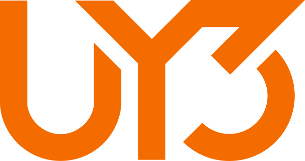
</p>

<h1 align="center">UY3 · Brand Guidelines</h1>

<p align="center">
  Manual de Identidade Visual, arquivos oficiais do logotipo, cores, tipografia e tokens da UY3.<br>
  <b>Versão 1.0 · Novembro 2026</b>
</p>

<p align="center">
  <a href="manual/Manual_de_Identidade_Visual_UY3_v1.0.pdf"><b>Baixar o manual (PDF)</b></a> ·
  <a href="#logotipo">Logotipo</a> ·
  <a href="#cores">Cores</a> ·
  <a href="#tipografia">Tipografia</a> ·
  <a href="#tokens-de-design">Tokens</a> ·
  <a href="#estrutura-do-repositório">Estrutura</a>
</p>

---

## Sobre

Este repositório é a fonte oficial da identidade visual da **UY3 Sociedade de Crédito Direto S.A.** Ele reúne o manual completo e todos os arquivos necessários para aplicar a marca em comunicação, documentos e interfaces digitais.

O manual em PDF é a referência normativa. Se este README e o manual divergirem, vale o manual.

**Quem usa este repositório:** marketing e comunicação, agências e fornecedores gráficos, produto e tecnologia, comercial e relacionamento, jurídico e compliance (na revisão de peças regulatórias).

## Manual de Identidade Visual

<p align="center">
  <a href="manual/Manual_de_Identidade_Visual_UY3_v1.0.pdf">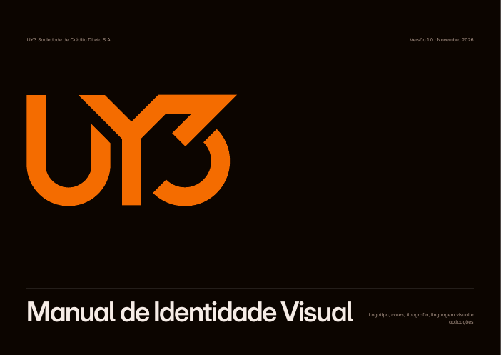</a>
</p>

📄 **[Manual_de_Identidade_Visual_UY3_v1.0.pdf](manual/Manual_de_Identidade_Visual_UY3_v1.0.pdf)**: 41 páginas, A4 paisagem (297 × 210 mm), texto pesquisável e fontes incorporadas.

| Capítulo | Conteúdo | Páginas |
|---|---|---|
| 01 · Abertura e fundamentos | Finalidade, contexto, personalidade, visão geral do sistema | 01–06 |
| 02 · Assinatura e uso do logotipo | Assinatura, anatomia, versões, área de proteção, tamanhos mínimos, fundos, co-branding, usos incorretos | 07–18 |
| 03 · Sistema cromático | Cor principal, composição degradê, cores de apoio, proporção, combinações, acessibilidade | 19–25 |
| 04 · Tipografia | Família, pesos, hierarquia, aplicação, informação financeira | 26–31 |
| 05 · Linguagem visual e composição | Grid, elementos gráficos, iconografia, fotografia, dados | 32–35 |
| 06 · Aplicações e governança | Papelaria, digital, site e interfaces, apresentações, checklist | 36–41 |

<table>
  <tr>
    <td>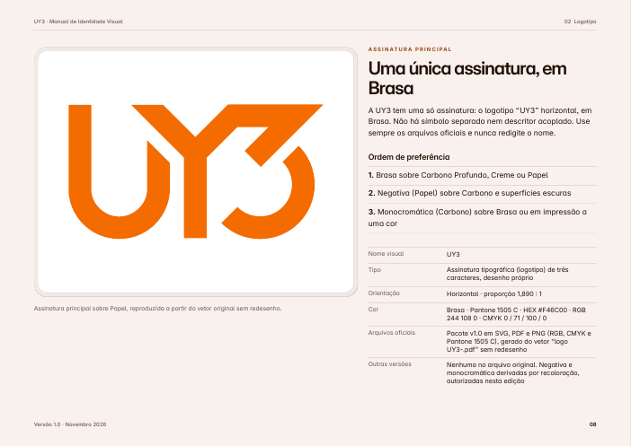</td>
    <td>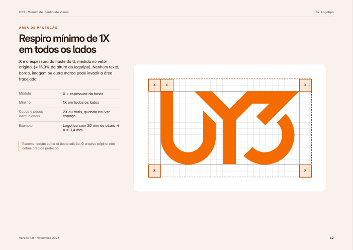</td>
    <td>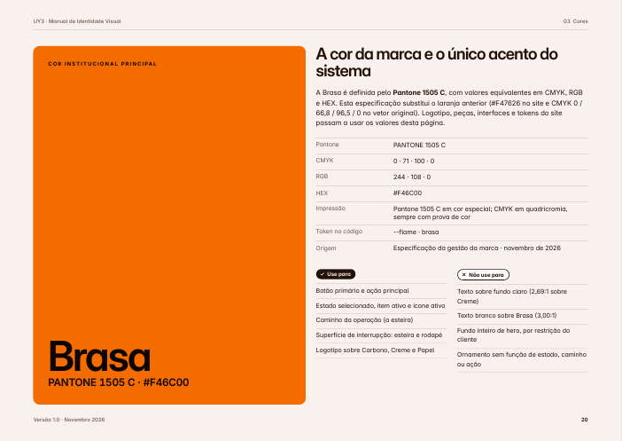</td>
  </tr>
  <tr>
    <td>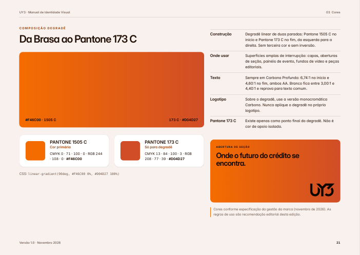</td>
    <td>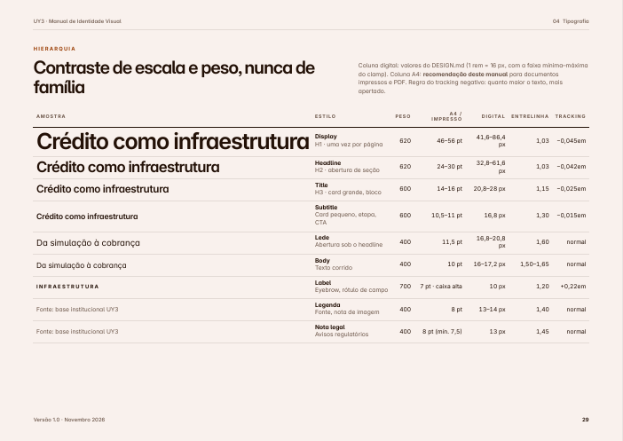</td>
    <td>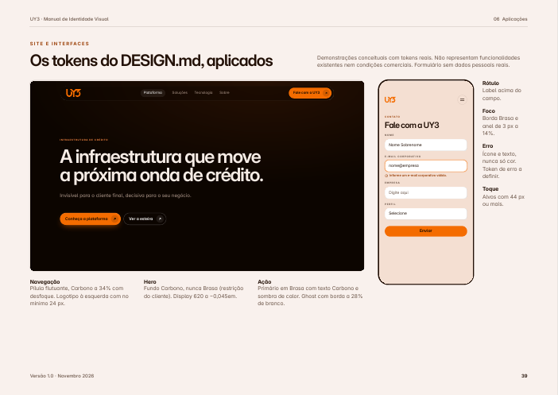</td>
  </tr>
</table>

---

## Logotipo

A UY3 tem **uma única assinatura**: o logotipo “UY3” horizontal. Ele existe em três versões de cor. Não há versão vertical, reduzida nem símbolo isolado, e nenhuma variação pode ser criada.

| | Versão | Uso | SVG | PDF | PNG |
|---|---|---|---|---|---|
| 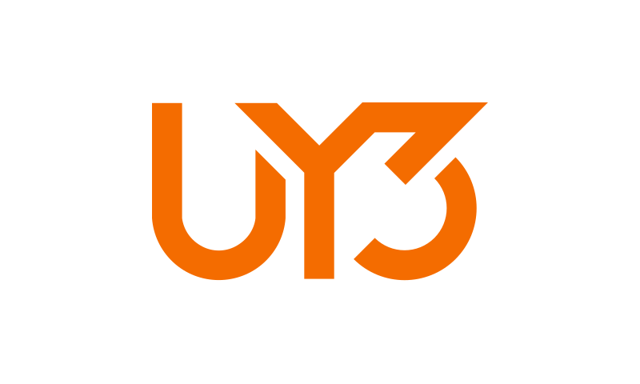 | **Principal · Brasa** | Preferencial sobre Papel, Creme e Carbono | [SVG](logotipo/svg/UY3_logo_principal_brasa.svg) | [RGB](logotipo/pdf/UY3_logo_principal_brasa_RGB.pdf) · [CMYK](logotipo/pdf/UY3_logo_principal_brasa_CMYK.pdf) · [Pantone 1505 C](logotipo/pdf/UY3_logo_principal_brasa_PANTONE-1505C.pdf) | [PNG](logotipo/png/UY3_logo_principal_brasa_2000px.png) |
| 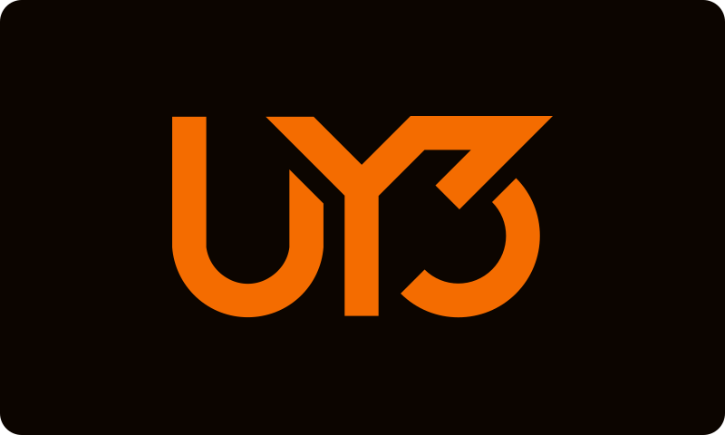 | **Principal sobre escuro** | Maior contraste da marca (6,74:1) | mesmo arquivo | mesmo arquivo | mesmo arquivo |
| 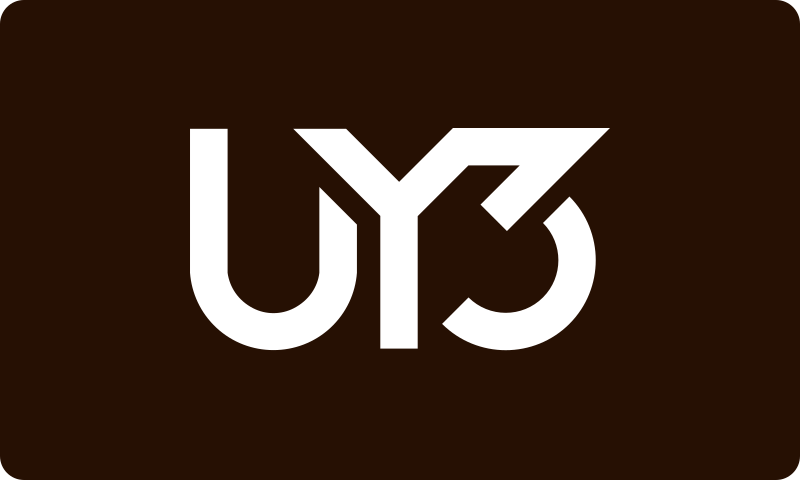 | **Negativa · Branco** | Sobre Carbono e imagens escuras | [SVG](logotipo/svg/UY3_logo_negativo_branco.svg) | [RGB](logotipo/pdf/UY3_logo_negativo_branco_RGB.pdf) | [PNG](logotipo/png/UY3_logo_negativo_branco_2000px.png) |
| 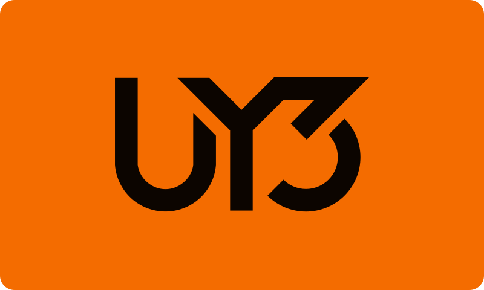 | **Monocromática · Carbono** | Única versão sobre a Brasa e o degradê; impressão a uma cor | [SVG](logotipo/svg/UY3_logo_mono_carbono.svg) | [RGB](logotipo/pdf/UY3_logo_mono_carbono_RGB.pdf) · [CMYK](logotipo/pdf/UY3_logo_mono_carbono_CMYK.pdf) | [PNG](logotipo/png/UY3_logo_mono_carbono_2000px.png) |

**Qual arquivo usar**

- **Web, interfaces e apresentações:** SVG.
- **Gráfica com cor especial:** PDF `PANTONE-1505C`, com a separação “PANTONE 1505 C” e alternativa CMYK.
- **Gráfica em quadricromia:** PDF `CMYK` (0 / 71 / 100 / 0).
- **Office, e-mail e ferramentas sem SVG:** PNG transparente com 2000 px de largura.

**Regras essenciais** (detalhes no capítulo 02 do manual)

- **Área de proteção:** 1X em todos os lados, sendo X a espessura da haste do U (≈ 16,9% da altura do logotipo).
- **Tamanho mínimo:** 6 mm de altura em impressão; 24 px de altura em tela (32 px recomendado).
- **Sobre a Brasa e sobre o degradê:** somente a versão monocromática Carbono.
- **Nunca:** distorcer, girar, recolorir fora das três versões, aplicar sombra ou brilho, separar ou recompor os caracteres, redigitar o nome em outra fonte ou usar letras isoladas (U, Y ou 3) como ícone.

<p align="center">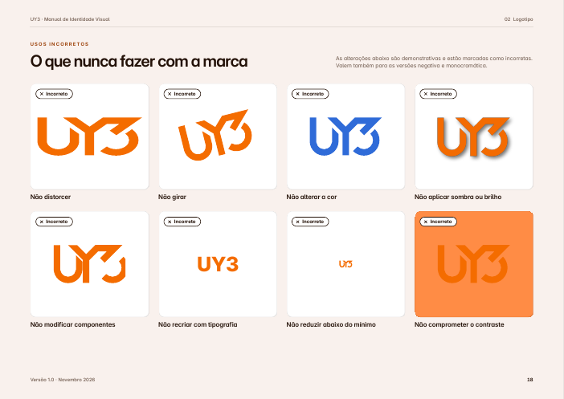</p>

Mais detalhes em [`logotipo/README.md`](logotipo/README.md).

---

## Cores

### Cor principal: Brasa

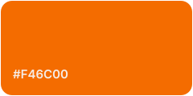

| Pantone | CMYK | RGB | HEX |
|---|---|---|---|
| **PANTONE 1505 C** | 0 · 71 · 100 · 0 | 244 · 108 · 0 | **#F46C00** |

A Brasa é a cor da marca e o **único acento** do sistema. Ela marca ação, estado ativo e caminho, e nunca é decoração. Texto sobre Brasa é sempre **Carbono Profundo** (6,74:1). Branco sobre Brasa fica em 3,00:1 e não serve para texto comum.

### Composição degradê

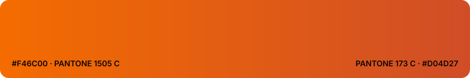

| Parada | Pantone | CMYK | RGB | HEX |
|---|---|---|---|---|
| Início | PANTONE 1505 C | 0 · 71 · 100 · 0 | 244 · 108 · 0 | #F46C00 |
| Fim | PANTONE 173 C | 13 · 84 · 100 · 3 | 208 · 77 · 39 | #D04D27 |

```css
background: linear-gradient(90deg, #F46C00 0%, #D04D27 100%);
```

- O degradê é linear e tem duas paradas, da esquerda para a direita, sem terceira cor e sem inversão.
- Use em superfícies amplas: capas, aberturas, painéis de evento, fundos de vídeo e peças editoriais.
- Texto e logotipo sobre o degradê vão sempre em Carbono Profundo (4,60:1 a 6,74:1).
- O Pantone 173 C existe só como ponto final do degradê. Não é cor de apoio isolada.

### Cores de apoio e neutras

| Amostra | Nome | HEX | CMYK (indicativo) | Função |
|---|---|---|---|---|
| 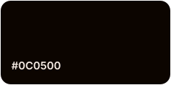 | Carbono Profundo | `#0C0500` | 66 · 66 · 51 · 100 | Fundo escuro principal: hero, rodapé, aberturas |
| 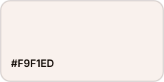 | Creme | `#F9F1ED` | 4 · 5 · 7 · 0 | Fundo claro padrão |
| 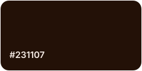 | Tinta | `#231107` | 31 · 72 · 62 · 99 | Texto principal sobre claro |
| 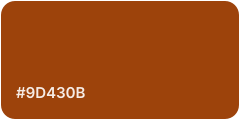 | Brasa Tinta | `#9D430B` | 0 · 73 · 100 · 43 | Texto de acento sobre claro (5,81:1) |
| 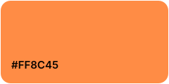 | Brasa Alta | `#FF8C45` | 0 · 56 · 79 · 1 | Acento sobre carbono (interface) |
| 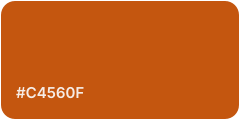 | Brasa Profunda | `#C4560F` | 2 · 70 · 98 · 22 | Bordas e ícones sobre claro; nunca texto pequeno |
| 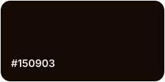 | Carbono | `#150903` | 56 · 68 · 51 · 100 | Degrau sutil sobre o Carbono Profundo |
| 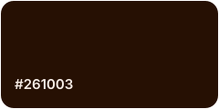 | Carbono Quente | `#261003` | 20 · 74 · 69 · 98 | Escuro alternativo |
| 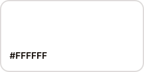 | Papel | `#FFFFFF` | 0 · 0 · 0 · 0 | Superfície de card sobre Creme |
| 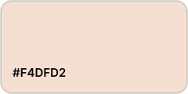 | Creme de Contato | `#F4DFD2` | 7 · 15 · 18 · 0 | Exclusivo da seção de contato do site |
| 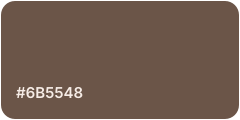 | Tinta Suave | `#6B5548` | 54 · 61 · 68 · 36 | Texto secundário sobre claro |
| 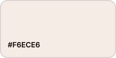 | Tinta Clara | `#F6ECE6` | 5 · 7 · 10 · 0 | Texto principal sobre carbono |
| 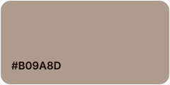 | Tinta Clara Suave | `#B09A8D` | 33 · 38 · 42 · 7 | Texto secundário sobre carbono |

Os valores CMYK das cores de apoio são **indicativos** (perfil FOGRA39, colorimétrico relativo) e dependem do perfil ICC da gráfica e de prova de cor. Os escuros resultam em pretos ricos e precisam de validação do fornecedor.

**Regras do sistema:**
- Não existe preto neutro nem cinza sem matiz: todo escuro é marrom queimado e todo claro é creme.
- Bordas são fios de 1 px em alfa (5–10%), nunca cinza opaco.

### Acessibilidade (WCAG 2.x)

| Par | Contraste | Texto normal (4,5:1) |
|---|---|---|
| Tinta sobre Creme | 16,31:1 | Passa |
| Brasa Tinta sobre Creme | 5,81:1 | Passa |
| Carbono Profundo sobre Brasa | 6,74:1 | Passa |
| Brasa sobre Carbono Profundo | 6,74:1 | Passa |
| Carbono Profundo sobre 173 C | 4,60:1 | Passa |
| Branco sobre Brasa | 3,00:1 | Reprova (só texto grande) |
| Brasa sobre Creme | 2,69:1 | Reprova |

A tabela completa está nas páginas 24 e 25 do manual.

---

## Tipografia

**Família única: [Inter](https://rsms.me/inter/)**, de Rasmus Andersson, sob a SIL Open Font License 1.1.

- Site oficial: <https://rsms.me/inter/>
- Repositório oficial: <https://github.com/rsms/inter>
- Versão incluída aqui: **Inter 4.1** ([release](https://github.com/rsms/inter/releases/tag/v4.1)), em [`tipografia/inter/`](tipografia/inter/)

| Peso | Nome | Uso |
|---|---|---|
| 400 | Regular | Corpo, lede, legendas, tabelas |
| 600 | SemiBold | Title, subtitle, botões, rótulos de card |
| 620 | Variável | Display e headline (requer a Inter variável; em Office e e-mail, use 600) |
| 700 | Bold | Label em caixa alta e ênfases curtas |

- **Alternativas de glifo:** `font-feature-settings: 'cv05' 1, 'cv11' 1, 'ss03' 1`.
- **Numerais tabulares** (`'tnum' 1`): use em tabelas e colunas de valores.
- **Tracking negativo:** quanto maior o texto, mais apertado (−0,045em no display).
- **Monoespaçada** (`ui-monospace`): admitida só dentro da janela de código do site.

Instalação e uso na web: [`tipografia/README.md`](tipografia/README.md).

---

## Tokens de design

Os tokens estão disponíveis em [`tokens/uy3-tokens.css`](tokens/uy3-tokens.css) (variáveis CSS) e [`tokens/uy3-tokens.json`](tokens/uy3-tokens.json). Eles cobrem cores, degradê, tipografia, raios e espaçamentos.

```css
@import "tokens/uy3-tokens.css";

.botao-primario {
  background: var(--uy3-brasa);
  color: var(--uy3-carbono-profundo);
  border-radius: var(--uy3-radius-pill);
  font-family: var(--uy3-font);
}
```

> ⚠️ O `DESIGN.md` do site ainda define a Brasa como `#F47626`. Atualize o token para `#F46C00` e a Brasa Lavada para `rgba(244,108,0,.12)`.

---

## Linguagem visual e aplicações

- **Casca dupla:** contêiner externo com raio de 2 rem e núcleo interno com raio calculado por subtração do respiro.
- **Botões:** sempre pill, com o ícone em círculo próprio encostado à direita.
- **Ícones:** traço fino de 1,5 a 1,8, viewBox 24, sem preenchimento.
- **Fotografia:** tecnologia aplicada e operação real. Nunca usar imagens de dinheiro, cofres, setas de crescimento, aperto de mão ou imagens genéricas de IA.
- **Dados:** Brasa para a série em foco, Tinta Suave para as demais, rótulo direto, fonte e data sempre informadas.

Os modelos de papelaria, redes sociais, site e apresentações estão no capítulo 06 do manual.

---

## Estrutura do repositório

```
brand-guidelines-uy3/
├── manual/            Manual de Identidade Visual em PDF
├── logotipo/
│   ├── svg/           Principal Brasa, negativo branco e mono Carbono
│   ├── pdf/           RGB, CMYK e Pantone 1505 C (cor especial)
│   └── png/           PNG transparente, 2000 px de largura
├── cores/
│   ├── amostras/      Amostras SVG da paleta
│   └── degrade-1505c-173c.svg
├── tipografia/
│   └── inter/         Distribuição oficial da Inter 4.1 (variável, estática, web e extras)
├── tokens/            Variáveis CSS e JSON
├── docs/              Relatório técnico de procedência e verificações
├── fonte-editavel/    HTML-fonte e scripts que geram o manual
└── assets/previews/   Imagens usadas neste README
```

## Governança

- Novas variações do logotipo, cores funcionais (sucesso, alerta, erro), banco de imagens e qualquer regra marcada no manual como recomendação dependem de aprovação da gestão da marca UY3.
- O [relatório técnico](docs/relatorio-tecnico.md) registra a origem de cada regra (confirmada, inferida ou recomendada), as verificações feitas e os pontos em aberto.
- O histórico de versões está em [`CHANGELOG.md`](CHANGELOG.md).
- Dúvidas e solicitações: área de Marketing da UY3.

## Licença

A marca UY3, o logotipo e o manual são propriedade da **UY3 Sociedade de Crédito Direto S.A.** e só podem ser usados conforme este manual. A fonte Inter é distribuída sob a SIL Open Font License 1.1. Veja [`LICENSE.md`](LICENSE.md).
