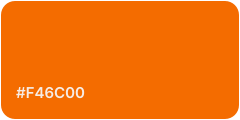
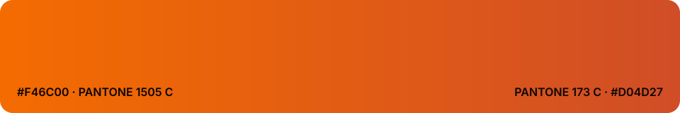

# Cores UY3

← [Voltar ao README principal](../README.md) · 📄 [Manual, capítulo 03 (páginas 19–25)](../manual/Manual_de_Identidade_Visual_UY3_v1.0.pdf)

## Brasa: cor principal da marca

| Sistema | Valor |
|---|---|
| Pantone | **PANTONE 1505 C** |
| CMYK | 0 · 71 · 100 · 0 |
| RGB | 244 · 108 · 0 |
| HEX | **#F46C00** |

## Composição degradê

| Parada | Pantone | CMYK | RGB | HEX |
|---|---|---|---|---|
| Início | PANTONE 1505 C | 0 · 71 · 100 · 0 | 244 · 108 · 0 | #F46C00 |
| Fim | PANTONE 173 C | 13 · 84 · 100 · 3 | 208 · 77 · 39 | #D04D27 |

`linear-gradient(90deg, #F46C00 0%, #D04D27 100%)`

**Regras de uso:**
- O degradê é linear e tem duas paradas, da esquerda para a direita.
- Use somente em superfícies amplas.
- Texto e logotipo sobre o degradê vão em Carbono Profundo.
- Nunca aplique o degradê no logotipo.
- O 173 C não é usado isoladamente.

## Arquivos

- [`amostras/`](amostras/): uma amostra SVG por cor da paleta.
- [`degrade-1505c-173c.svg`](degrade-1505c-173c.svg): faixa do degradê.
- Tokens prontos para código: [`../tokens/`](../tokens/).
