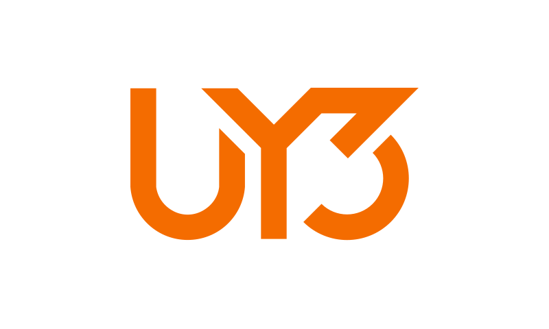
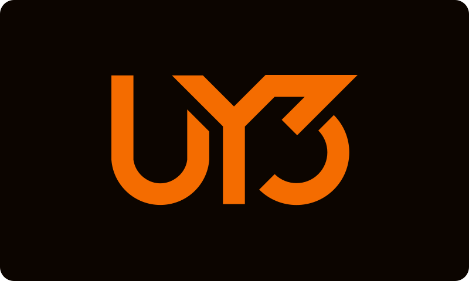
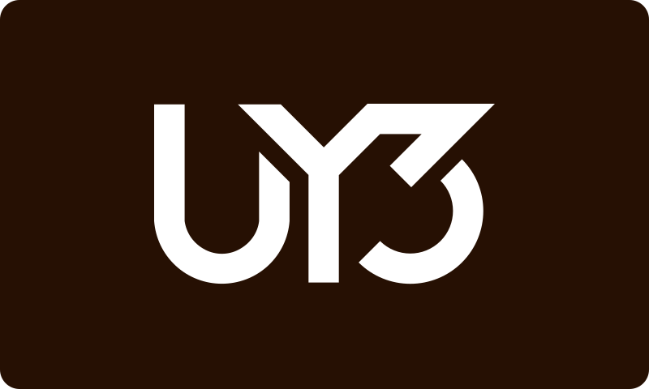
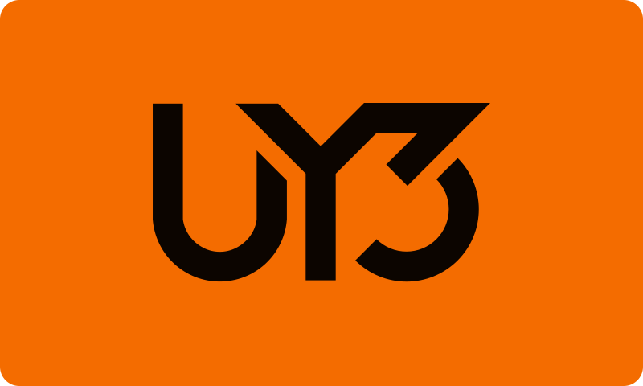

# Logotipo UY3

Arquivos oficiais da assinatura UY3, versão 1.0 (novembro de 2026). Todos foram gerados a partir do vetor original da marca, **sem redesenho**. Só a cor muda entre as versões.

← [Voltar ao README principal](../README.md) · 📄 [Manual, capítulo 02 (páginas 07–18)](../manual/Manual_de_Identidade_Visual_UY3_v1.0.pdf)

## Arquivos

| Versão | Cor | SVG | PDF | PNG (2000 px) |
|---|---|---|---|---|
| Principal · Brasa | Pantone 1505 C · CMYK 0/71/100/0 · RGB 244 108 0 · #F46C00 | [`UY3_logo_principal_brasa.svg`](svg/UY3_logo_principal_brasa.svg) | [`RGB`](pdf/UY3_logo_principal_brasa_RGB.pdf) · [`CMYK`](pdf/UY3_logo_principal_brasa_CMYK.pdf) · [`PANTONE-1505C`](pdf/UY3_logo_principal_brasa_PANTONE-1505C.pdf) | [`PNG`](png/UY3_logo_principal_brasa_2000px.png) |
| Negativa · Branco | #FFFFFF | [`UY3_logo_negativo_branco.svg`](svg/UY3_logo_negativo_branco.svg) | [`RGB`](pdf/UY3_logo_negativo_branco_RGB.pdf) | [`PNG`](png/UY3_logo_negativo_branco_2000px.png) |
| Monocromática · Carbono | #0C0500 · CMYK indicativo 66/66/51/100 | [`UY3_logo_mono_carbono.svg`](svg/UY3_logo_mono_carbono.svg) | [`RGB`](pdf/UY3_logo_mono_carbono_RGB.pdf) · [`CMYK`](pdf/UY3_logo_mono_carbono_CMYK.pdf) | [`PNG`](png/UY3_logo_mono_carbono_2000px.png) |

  
  
  
  

## Especificações técnicas

- **Proporção:** 1,890 : 1 (622,43 × 329,32 pt na prancheta dos PDFs).
- **Prancheta:** ajustada ao desenho, sem margem. Respeite a área de proteção ao aplicar.
- **PDF Pantone:** espaço de cor especial (Separation) nomeado `PANTONE 1505 C`, com alternativa CMYK 0/71/100/0.
- **PDF CMYK:** DeviceCMYK, sem perfil embutido. Faça prova de cor com o perfil da gráfica.
- **Mono CMYK:** Carbono em preto rico (66/66/51/100). Para gravação, carimbo ou impressão a uma cor, confirme com o fornecedor.
- **Negativa:** em impressão, o branco depende de tinta branca, hot stamping ou vazado. Não use o PDF negativo sobre papel branco.

## Regras de uso

| Regra | Especificação |
|---|---|
| Área de proteção | 1X em todos os lados (X = espessura da haste do U, ≈ 16,9% da altura) |
| Tamanho mínimo, impressão | 6 mm de altura (≈ 11,3 mm de largura) |
| Tamanho mínimo, digital | 24 px de altura (≈ 45 px); recomendado 32 px |
| Sobre Brasa ou degradê | Somente monocromática Carbono |
| Sobre fotografia | Área limpa, ou placa sólida de Carbono com 1X de respiro |
| Co-branding | Equivalência óptica, 2X até o separador de 1 px a 25% e 2X até a marca parceira |

**Nunca:**
- Distorcer ou girar o logotipo.
- Recolorir fora das três versões.
- Aplicar sombra, brilho ou degradê no logotipo.
- Separar ou recompor os caracteres.
- Redigitar o nome em outra fonte.
- Reduzir abaixo do mínimo.
- Usar letras isoladas (U, Y ou 3) como ícone, avatar ou marca-d’água.

> A área de proteção e os tamanhos mínimos são recomendações desta edição, definidas por teste de legibilidade e sujeitas a validação em prova de impressão.
